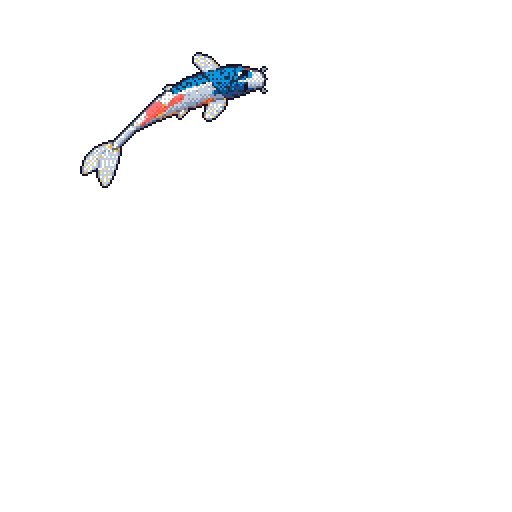

# Hi there, I'm Tejas Mankeshwar 👋

  

  <b>AI/ML Engineer · Researcher · Software Developer</b>

  Building intelligent systems, exploring the mathematics behind AI, and turning research into real-world applications.

  <a href="https://www.linkedin.com/">LinkedIn</a> •
  <a href="https://github.com/">GitHub</a> •
  <a href="mailto:your-email@example.com">Email</a>

---

### 🧑‍💻 About Me

- 🎓 MS in Computer Science student at **University of Massachusetts Amherst**.
- 🔬 Previously worked as an **Artificial Intelligence Research Intern**, exploring optimization algorithms and machine learning.
- 📝 Contributed to 10 research works, including peer-reviewed Springer book chapters, research papers, and a granted patent.
- 🧠 Interested in understanding the theoretical foundations of AI and building practical applications around them.
- 🛠️ I enjoy building things from scratch, experimenting with new technologies, and solving problems that sit at the intersection of mathematics and computer science.
- 🌱 Currently exploring the deeper workings of Large Language Models.

### 🔬 Research Interests

I'm particularly interested in:

- **Large Language Models:** Learning dynamics, reasoning, evaluation, and interpretability.
- **Trustworthy NLP:** Reliability, alignment, and evaluating model behavior.
- **Optimization:** Multi-objective optimization, metaheuristics, and computational optimization.
- **Machine Learning:** Statistical learning, deep learning, and algorithmic foundations.

### ⚙️ Tech Stack

**Languages**

`Python` `C++` `Java` `JavaScript` `TypeScript` `Swift` `SQL`

**AI / Machine Learning**

`PyTorch` `Scikit-learn` `Hugging Face` `Transformers` `RDKit` `Sentence Transformers`

**Development**

`React` `Node.js` `Streamlit` `Tauri` `SwiftUI` `Tailwind CSS`

**Tools & Platforms**

`Git` `GitHub` `Docker` `VS Code` `Ollama` `Linux`

### 🚀 Featured Projects

**Wispr Flow — AI-powered Dictation**

An intelligent voice-to-text application combining speech recognition and LLM-powered text refinement to make everyday writing faster and more natural.

`Python` `Whisper` `Gemini API` `Ollama` `Tauri` `SwiftUI`

**Wateroo — Smart Reminder Application**

A productivity-focused application designed to make reminders and everyday task management simpler.

**Optimization & Drug Discovery Research**

Exploring computational optimization techniques and their applications in drug discovery, molecular modeling, and machine learning.

`Python` `PyTorch` `RDKit` `Optimization`

### 🏆 Research & Achievements

- Published 6 book chapters in Springer's *Encyclopedia of Engineering Optimization and Heuristics*.
- Published 2 Scopus-indexed research works.
- Contributed to 10 research works and a granted patent.
- Reviewed 2 conferences, including 4 research papers.
- 2nd Runner-up in a research competition at PICT Institute.
- Winner of 8+ hackathons.
- Former Google Developer Groups Lead and Project Lead at CODE.

### 📊 GitHub Statistics

  
  

  

---

  <i>"Stay curious. Build relentlessly. Understand deeply."</i>

  Thanks for stopping by! ⭐

<!--
**TejasMankeshwar/TejasMankeshwar** is a ✨ _special_ ✨ repository because its `README.md` (this file) appears on your GitHub profile.

Here are some ideas to get you started:

- 🔭 I’m currently working on ...
- 🌱 I’m currently learning ...
- 👯 I’m looking to collaborate on ...
- 🤔 I’m looking for help with ...
- 💬 Ask me about ...
- 📫 How to reach me: ...
- 😄 Pronouns: ...
- ⚡ Fun fact: ...
-->
